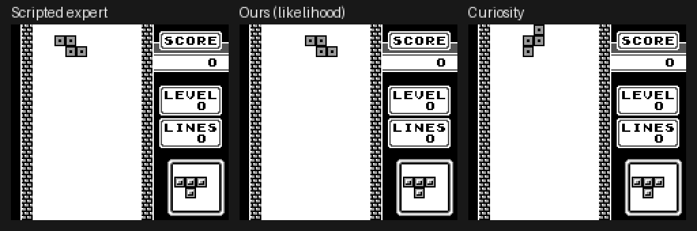

# TetrisFormer

**Learning rewards from machine state.** A small transformer is trained on Game Boy RAM traces of competent
play, and its predictive likelihood over future memory states is used as the reward for an RL agent that also
acts purely on RAM. No hand-written reward code, no pixels, no action labels.

This repo is a **2-day proof of concept on Game Boy Tetris**. The full research plan (targeting Super Mario Land
and Pokémon) is in [`PLAN.md`](PLAN.md).



*Left: scripted expert (the source of training data). Middle: agent trained on the learned likelihood reward
(3M steps). Right: "curiosity" agent, the same reward model with the sign flipped. Same piece sequence for all three.*

## What it shows

| | Result |
|---|---|
| Reward model | 0.9M-param byte-token transformer predicts held-out expert RAM at **0.040 nats/byte**, 12× better than copying the last state |
| Reward ranking | Per-step median log p (3M steps): expert −5 > **ours −16** (3 seeds) > hand-reward agent −40 (3 seeds) > random −106 |
| Pause exploit | Both hand-written rewards were hacked by pausing the game; the learned reward scores pausing *worst* |
| Curiosity (−log p) | Pauses on 94% of steps (the RAM "noisy TV"); same model, opposite sign, opposite behaviour |
| Interpretability | Each failure maps to a few RAM addresses (falling-piece sprites, sound driver, stack) |
| Playing Tetris | ❌ No agent clears lines, even after 3M steps × 3 seeds. Our reward plateaued by ~300k; button-level PPO exploration is the bottleneck |

**Report** (problem statement, work done, implementation, results, discussion): **[`REPORT.md`](REPORT.md)** · [PDF](REPORT.pdf).
Short results summary with caveats: [`RESULTS.md`](RESULTS.md).

## How it works

```
emulator (PyBoy) ──RAM──▶ policy (RAM input) ──action──▶ emulator
        │
        └──RAM history──▶ reward transformer (frozen) ──r_t──▶ PPO
```

1. **Environment** (`env.py`): PyBoy Tetris. The observation is work RAM (0xC000–0xDFFF, 8 KB) every 24
   frames; the 8 actions are the buttons plus no-op. Bytes that churn regardless of input (sound driver, stack)
   are masked out.
2. **Expert data** (`expert.py`, `collect.py`): a scripted placement heuristic plays 100 games
   (53 lines/game, 183k steps). Only its RAM is kept, not its actions. See [`notes/scripted-expert.md`](notes/scripted-expert.md).
3. **Reward model** (`rm.py`): each of 289 varying RAM bytes is a token (value + address + time embedding).
   A block-causal transformer (8 steps × 289 bytes = 2,312 tokens) predicts every byte of the next state.
4. **RL** (`ppo.py`, `rl.py`): PPO with an MLP over one-hot RAM. Reward = normalized Σ log p(s_{t+1} | history)
   + an RND exploration bonus.
5. **Analysis** (`analyze.py`, `make_gif.py`): results table, per-address log-p gaps, this GIF.

## Running it

You need your own legally obtained Tetris (GB) ROM at `roms/tetris.gb` (not included; SHA-1 in
[`notes/roms.md`](notes/roms.md)).

```bash
uv venv --system-site-packages .venv && uv pip install --python .venv/bin/python -r requirements.txt
.venv/bin/python env.py                 # determinism test, throughput, volatile mask
.venv/bin/python collect.py 100 20      # expert + random RAM traces
.venv/bin/python rm.py --name rm        # train reward model (~15 min on an RTX 5060 laptop)
.venv/bin/python rm.py --name rm_nomask --nomask
.venv/bin/python rl.py --name ours --ent 0.05 --beta 0.5 --steps 300000
.venv/bin/python analyze.py

# 3M-step runs (~23 h on one laptop): ours ×3 seeds, hand ×3, no-mask, curiosity
sh run_3m.sh
.venv/bin/python analyze.py runs/analysis_3m.json ours_3m_s0 ours_3m_s1 ours_3m_s2 nomask_3m_s0 curiosity_3m_s0 hand_3m_s0 hand_3m_s1 hand_3m_s2
.venv/bin/python plot_training.py 3m && .venv/bin/python make_gif.py 3m
```

Note: `env.py` writes the volatile mask, but the policy address set (`data/policy_addresses.npy`) was built by an
inline snippet; see the P2 notes in `phases/poc.md`.
Policy checkpoints (71 MB each) are not in the repo; the two reward models (`runs/rm*/model.pt`) are.

## Process

The project ran against written checklists, with every change of plan approved by a human and logged:

- [`CLAUDE.md`](CLAUDE.md): working rules (checklist is the contract, log every discrepancy)
- [`phases/poc.md`](phases/poc.md): the PoC checklist, each ticked item with evidence
- [`DEVIATIONS.md`](DEVIATIONS.md): 11 approved deviations from the plan (D-001–D-011)
- [`notes/log.md`](notes/log.md): every discrepancy and noteworthy event
- [`notes/reward-hacking.md`](notes/reward-hacking.md): 4 catalogued reward hacks
- [`notes/related-work.md`](notes/related-work.md): literature sweep (closest prior work: VIPER, IL-flOw)

## Caveats

3M RL steps with 3 seeds for ours and hand (1 for no-mask and curiosity; only one ours seed used the KL guard), Tetris instead of SML, and a hand-written heuristic as the expert. The "ours scores
best" comparison uses the same reward model that trained it, so it is partly circular. Treat this as a
feasibility check, not a result. Details in [`RESULTS.md`](RESULTS.md).
