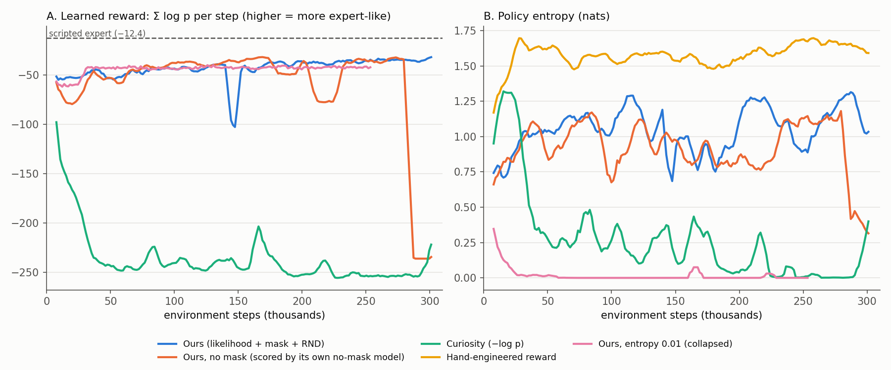
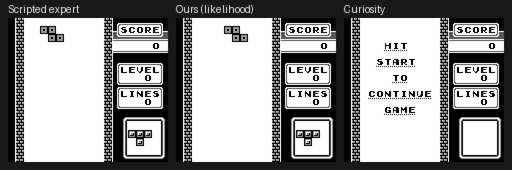

# Learning Rewards from Machine State: A Proof of Concept on Game Boy Tetris

**Author:** D-VSpec · **Date:** November 2026 · **Code:** https://github.com/D-Vspec/TetrisFormer

---

## Abstract

Reinforcement learning (RL) agents need a reward function. Hand-writing one takes per-game domain knowledge
and is easy to exploit. We test whether the reward can instead be *learned from the machine state of a game
console*. An autoregressive transformer is trained on Game Boy work-RAM traces of competent play, and its
predictive log-likelihood over the next RAM state is used as a dense reward for an RL agent that also acts
purely on RAM. No pixels, no action labels and no hand-written reward code enter the reward.

In a two-day proof of concept on Tetris:
- A 0.9M-parameter byte-token transformer predicts held-out expert RAM at 0.040 nats/byte, 12× better than a
  copy-last-state baseline, and rates random play about 10× less likely per step than expert play.
- Under this learned reward, the pause exploit that broke both of our hand-written rewards becomes the
  worst-scoring behaviour.
- The same model with the sign flipped (a curiosity reward) reproduces the known "noisy-TV" failure: the agent
  pauses on 76% of steps.
- Failure modes can be traced to specific RAM addresses.
- However, no agent learned to clear lines within the 300k-step training budget, and part of our evaluation is
  circular.

We conclude that the reward signal behaves sensibly and is interpretable, while exploration with button-level
PPO is the current bottleneck.

---

## 1. Problem statement

### 1.1 Motivation
An RL agent learns to maximise a reward signal. Hand-written rewards have two problems:

1. **Effort and domain knowledge.** Someone has to know which game variables matter (position, score, level
   flags) and how to weight them. This has to be redone for every game.
2. **Reward hacking.** Agents find behaviours that score well without doing what the designer intended. We hit
   this twice during this project (§5.5).

Learned rewards avoid hand-writing, but those learned over pixels are hard to debug: when the agent exploits
the reward, it is unclear *what* in the image it is exploiting.

### 1.2 Idea
A game console's work RAM (WRAM, 8 KB on the Game Boy) holds the game's logical state *exactly*: board
contents, piece positions, timers, sound-engine state. The state is discrete, compact and fully observable.

We train a sequence model on RAM traces of good play and reward the agent for producing RAM trajectories that
the model finds likely:

$$r_t = \log p_\theta(s_{t+1} \mid s_{t-T+1}, \dots, s_t)$$

where $s_t$ is the RAM snapshot at agent step $t$. This is the idea of VIPER (Escontrela et al., 2023), which
uses video frames, applied to exact machine state instead.

### 1.3 Research questions (for this proof of concept)
- **Q1.** Can a small transformer model Game Boy RAM dynamics of expert play well enough to separate expert
  from non-expert behaviour?
- **Q2.** Does its likelihood work as an RL reward with no other task information?
- **Q3.** Because RAM is exact, can failure modes and reward hacking be explained at the level of individual
  memory addresses?
- **Q4.** How does the likelihood reward compare with a hand-engineered reward and with a curiosity reward
  (the same model with the opposite sign)?

### 1.4 Scope
The original research plan (`PLAN.md`) targets Super Mario Land and Pokémon over several months. This report
covers a **two-day proof of concept on Tetris**: the only suitable ROM available on the machine. The PoC
checklist is `phases/poc.md`.

---

## 2. Background and related work

- **VIPER** (Escontrela et al., NeurIPS 2023) trains an autoregressive video model on expert videos and uses
  the log-likelihood of the next frame as reward, plus an exploration bonus. Our method is the RAM analogue.
  VIPER also notes that likelihood alone favours "most-probable" degenerate behaviour (e.g. standing still) and
  converges early to local optima. We observed both.
- **Observation-only density rewards.** IL-flOw (Chang et al., 2021) uses expert state-transition density as a
  reward on low-dimensional robot states. So *likelihood as reward* is not new; what is new here is exact,
  discrete *machine state* with a transformer, and byte-level interpretability.
- **Curiosity** (Schmidhuber 1991; Pathak et al., ICML 2017; Burda et al., ICLR 2019) rewards prediction
  *error*. Its known failure is the "noisy TV": agents get stuck on unpredictable stimuli. We use it as the
  opposite-sign baseline.
- **RAM as state.** AtariARI (Anand et al., 2019) and OCAtari (Delfosse et al., 2024) use Atari RAM as ground-truth
  state for representation learning, not for reward learning.
- **Game Boy RL.** PokeRL (Mudireddy & Patibandla, 2026) uses hand-designed RAM rewards with pixel policies.
  Rank-Then-Act (Maksyuta et al., 2026) learns a progress reward from expert *video* with a 7B vision-language
  model, on PyBoy games including Kirby.

A literature sweep (`notes/related-work.md`) found no prior work using likelihood over console RAM as a
learned reward.

---

## 3. Work done

### 3.1 Process
The work was organised around written phase checklists. Any departure from a checklist needed human approval
and was logged. The project has 9 approved deviations (`DEVIATIONS.md`), a catalogue of reward hacks
(`notes/reward-hacking.md`), and an event log of every discrepancy (`notes/log.md`). The main steps:

| Step | Outcome |
|---|---|
| Literature sweep | No direct prior work; claims narrowed to "VIPER on exact machine state" (D-003); VIPER-style exploration bonus added (D-002) |
| Scope change | Full plan compressed to a 2-day PoC on Tetris (D-004) |
| Environment | Deterministic PyBoy Tetris env with RAM observations and a volatile-byte mask |
| Hand-engineered baseline | Exploited twice through the pause button (H-001, H-002); reward fixed (D-006) |
| Expert data | PPO could not produce competent play, so a scripted expert was written instead (D-005) |
| Reward model | 0.9M-param transformer; address set widened to all 289 varying bytes (D-007) |
| RL with learned reward | First run collapsed to one action (H-003); exploration fixed via pilots (D-008) |
| Final runs | 300k steps each for 4 reward variants (D-009); analysis, figure, GIF |

### 3.2 Changes from the original plan, and why
- **Tetris instead of Super Mario Land:** no SML ROM was available.
- **Scripted expert instead of TAS/human/RL data:** a Tetris TAS gives only ~2k agent steps, and our PPO agent
  never cleared a line. A heuristic player gave 100 competent games in 5 minutes.
- **300k RL steps instead of 3M:** the learned reward costs ~14 GFLOPs per step, so RL ran at only ~126 steps/s,
  and the report was needed within hours.

---

## 4. Implementation

All code is in the repository root; each component is a single file.

### 4.1 Environment (`env.py`)
- **Emulator:** PyBoy 2.9, headless, unthrottled (~6,000 frames/s per instance).
- **Observation:** WRAM 0xC000–0xDFFF (8,192 bytes) as `uint8`, sampled every **24 frames** (one agent step).
  CPU registers are excluded because they reflect when the snapshot was taken, not game state.
- **Actions:** 8 discrete: ↑ ↓ ← → A B Start, no-op. A button is pressed for one frame, then 24 frames are
  emulated.
- **Episodes:** start with `reset_game(timer_div)`, where `timer_div` seeds Tetris's piece generator (random per
  episode). They end at game over or after 2,000 steps.
- **Determinism:** the same seed and actions give byte-identical RAM traces (asserted in `env.py`).
- **Parallelism:** 12 subprocess environments, ~1,000–1,500 agent steps/s.

### 4.2 Volatile-byte mask
Some bytes change regardless of what the player does (sound engine, stack). A likelihood model would waste
capacity on them, and a curiosity agent would chase them. We ran no-op and random rollouts and masked bytes
that change on ≥60% of no-op steps.
- **Result:** 8 bytes, the sound driver (0xDF94–0xDFC4) and one stack byte (0xCFED).
- **Discrepancy:** the planned rule, "changes on ≥95% of steps", masked nothing, because Tetris keeps its frame
  counter and random-number state outside WRAM.
- **Observation:** only 278 of the 8,192 WRAM bytes ever change during play.

### 4.3 Expert data (`expert.py`, `collect.py`)
A scripted player supplies the "competent play" traces:
- **Perception:** it reads the landed blocks from the background tilemap and the falling piece from the sprites.
- **Planning:** for each new piece it tries every rotation × column, simulates the drop, and scores the
  resulting board with a standard linear heuristic: −0.51·height + 0.76·lines − 0.36·holes − 0.18·bumpiness.
- **Execution:** it presses buttons through the *same* `env.step`, closed loop (rotate until the on-screen shape
  matches, shift to the target column, soft-drop). Its RAM traces therefore have exactly the timing the RL
  agent sees.

**Data:** 100 games, 183,044 steps, 53.3 lines/game (random play: 0). Only RAM is stored, not actions.
Details: `notes/scripted-expert.md`.

### 4.4 Reward model (`rm.py`)
**Tokenisation.** Every byte that varies in the expert data, minus the mask, is one token: K = 289 addresses.
180 of them are the 18×10 playfield copy at 0xC800. A token's embedding is

$$e = E_\text{value}[\text{byte}] + E_\text{address}[k] + E_\text{time}[t].$$

Byte values are embedded as categories, not scalars, because map or tile IDs are not ordinal.

**Architecture.** Decoder-only transformer, d = 128, 4 layers, 4 heads, FFN 512, pre-norm: **897,152
parameters**.
- **Context:** T = 8 steps, so 8 × 289 = 2,312 tokens.
- **Block-causal attention:** every token of step t attends to all tokens of steps ≤ t, and predicts the value
  of *its own address* at step t+1 (a 256-way softmax).
- **Shared output head:** one small 128→256 head is shared across all addresses. This weight sharing is why the
  model is small; an equivalent step-level model with a flat output layer would need ~19M parameters for the
  output alone.

**Training.**
- **Objective:** cross-entropy over all predicted bytes.
- **Optimiser:** AdamW at 1e-3 with a one-cycle schedule, batch of 32 windows, 3,000 iterations (~220M tokens),
  bf16.
- **Data split:** by game (90 train, 10 validation), so validation games are entirely unseen.
- **Time:** ~15 minutes on an RTX 5060 laptop GPU.
- **No-mask variant:** an identical model that also includes the 8 volatile bytes (K = 297).

### 4.5 Learned reward and RL (`rl.py`, `ppo.py`)
**Reward.**

$$r_t = \text{norm}\Big(\sum_{k} \log p_\theta(s_{t+1}^{(k)} \mid s_{t-7..t})\Big) + \beta\,\text{norm}(r^\text{RND}_t)$$

- The sum runs over the unmasked addresses.
- $\text{norm}$ is a running mean/std normalisation.
- $r^\text{RND}$ is a Random Network Distillation novelty bonus with β = 0.5, the exploration term VIPER also uses.
- The reward model is frozen; a checksum is asserted unchanged after each run.
- At the start of an episode, the history is padded with the first state.

**Policy.**
- An MLP over one-hot RAM (271 bytes that change in no-op/random play, minus the mask): one-hot → 256 → 256
  → policy and value heads. That's 17.8M parameters, almost all in the one-hot input layer.
- The policy does not share an encoder with the reward model, so it can't co-adapt with it.

**PPO settings.** 12 envs, 128-step rollouts, γ = 0.99, λ = 0.95, clip 0.2, 4 epochs, 8 minibatches,
learning rate 2.5e-4, **entropy coefficient 0.05** (raised from 0.01 after the collapse in §5.4).

**Compared reward variants.** Policy, PPO config and budget (300k steps, 1 seed) are identical; only the
reward differs:

| Variant | Reward |
|---|---|
| Hand-engineered | 1.0 per line cleared + 0.1 per piece locked |
| **Ours** | likelihood + mask + RND |
| Ours, no mask | likelihood from the no-mask model + RND |
| Curiosity | −likelihood + RND (only the sign differs from ours) |

### 4.6 Analysis (`analyze.py`, `plot_training.py`, `make_gif.py`)
- **Evaluation:** 24 episodes per policy with sampled actions; lines cleared and episode length.
- **Scoring:** each policy's states are scored with the (masked) reward model over 8 episodes, excluding the
  terminal transition.
- **Per-address gap:** the expert's mean log p minus the agent's mean log p, per address.

---

## 5. Results

### 5.1 Q1: the reward model separates expert from non-expert play

| Evaluation data | NLL (nats/byte) ↓ |
|---|---|
| Expert, 10 held-out games | **0.040** |
| Copy last state (best ε-smoothing, ε = change rate 0.053) | 0.505 |
| Per-address unigram | 0.715 |
| Random-play traces | 0.417 |

The model beats the copy baseline by 12× and rates random play ~10× less likely per byte than expert play.
The no-mask model reaches the same validation NLL (0.040).

Measured *online*, by running each fixed policy through the environment and reward pipeline on unseen seeds,
the per-step log p is:

| Expert | Always → | No-op | Always ← | Always ↓ | Random | Always Start (pause) |
|---|---|---|---|---|---|---|
| **−12.4** | −34.5 | −41 to −52 | −45 | −46 | −121 | **−257** |

The expert's online score matches the offline evaluation (−11.7), which confirms that states and rewards are
aligned correctly in the RL loop.

### 5.2 Q2/Q4: RL with the learned reward

*Figure 1. (A) Raw learned reward per step during training; the hand-engineered run has no log-p curve because
it was trained on its own reward. (B) Policy entropy (maximum ln 8 ≈ 2.08). Rolling mean over 5 PPO updates.*

| Run | Lines/game | Episode length | log p/step (mean) | log p/step (**median**) | Dominant action |
|---|---|---|---|---|---|
| Scripted expert | 53.3 | 1830 | −13.8 | **−5.1** | (rotate → shift → drop) |
| Random | 0.0 | 448 | −109 | −106 | — |
| Hand-engineered | 0.0 | 178 | −72 | −33 | ↓ 29% |
| **Ours** | 0.0 | 159 | **−38** | **−12.6** | ↓ 59% |
| Ours, no mask | 0.0 | 822 | −81 | −107 | ← 76% |
| Curiosity | 0.04 | 525 | −197 | −144 | **Start 76%** |

*Lines and length: 24 evaluation episodes. Log p: masked reward model, 8 episodes, terminal transition excluded.*

Observations:
- **No variant clears lines** in 300k steps. The independent task metric does not separate the methods.
- **Ours ranks first under the reward model.** Its median step (−12.6) is close to the expert's per-step level.
  Its training curve (Fig. 1A) rose from −52 to −30 and was still rising when training stopped.
- **The hand-engineered agent was never trained on log p, yet it scores between random and ours.** This is weak
  independent evidence that the reward model tracks "reasonable" play.
- **Rewards are heavy-tailed.** Most of our agent's steps look expert-like, but rare, very unlikely steps (e.g.
  topping out) pull the mean down.
- **The no-mask run changed behaviour abruptly at ~285k steps** (Fig. 1). Its log p, under its own model, fell
  from ~−40 to ~−235, its entropy fell, and it switched to pressing ← on 76% of steps. We have not explained why
  an agent would move to a much lower raw likelihood; RND domination or the running-normalisation baseline are
  candidates.

### 5.3 Q3: byte-level attribution
Largest per-address gaps between expert and agent (nats, masked model):

| Agent | Top addresses | Interpretation |
|---|---|---|
| Ours | 0xC203 (1.67), 0xC018, 0xC01C, 0xC014, 0xC010 (~1.0) | 0xC010–0xC01D is the shadow sprite table, i.e. the falling piece's position. The agent moves pieces unlike the expert. 0xC203 is unidentified. |
| Hand-engineered | 0xC014, 0xC018, 0xC010, 0xC203 (~2.5) | same addresses, larger gaps |
| Random | 0xDFBE, 0xCFF1, 0xDFAE, 0xC018 (~3.5) | sound-engine state, stack, piece |
| Ours, no mask | 0xDFBE, 0xDFAA, 0xDF9E, 0xCFF1 (~3) | sound engine + stack: the bytes the mask removes |
| Curiosity | 0xC014, 0xC018, 0xC210, 0xCFF1 (~7.5) | piece sprites frozen/hidden by the pause screen |

Each behaviour maps onto a small, nameable group of addresses. Note that these gaps say *where* an agent's
states differ from the expert's, not *why*.

### 5.4 Exploration failure: the collapse (H-003)
With PPO's default entropy coefficient (0.01), the likelihood-trained policy **collapsed to pressing → on every
step within 150k steps** (entropy 1.7e-5; Fig. 1B, pink).
- **Not a bug:** the online measurement in §5.1 shows "always →" is the best *trivial* policy (−34.5/step), far
  below the expert (−12.4). This is the local optimum VIPER warns about.
- **Pilots:** entropy 0.05 prevented the collapse. Entropy 0.05 *plus a stronger novelty bonus* (β = 2)
  collapsed faster, to "always ↓". A stronger exploration bonus made things worse.

### 5.5 Reward-hacking catalogue

| ID | Reward | What the agent did |
|---|---|---|
| H-001 | Hand v1: lines + 0.01 per step survived | Pressed Start once to pause the game, then farmed the survival reward until the step limit |
| H-002 | Hand v2: lines + 0.1 per piece | The pause screen adds 28 non-empty tiles, which my piece detector counted as locks. Pressed Start on 83% of steps (a bug in my reward code; fixed) |
| H-003 | Likelihood, entropy 0.01 | Collapse to "always →" (exploration failure) |
| H-004 | Curiosity (−log p) | Pauses on 76% of steps: the never-seen pause screen is the most surprising state available (noisy TV) |

The likelihood reward scores pausing *worst* (−257/step), so the exploit behind H-001 and H-002 does not
transfer to it. Curiosity, using the *same* model, makes pausing *best*. So the sign of the reward, not the
model, determines this behaviour.

*Figure 2. Same piece sequence. Left: scripted expert. Middle: our agent (drops pieces fast and tops out).
Right: curiosity agent (paused).*

---

## 6. Discussion

### 6.1 What the proof of concept supports
1. **RAM is an easy modelling target.** A sub-1M-parameter model predicts the next RAM state almost perfectly
   for expert play (0.04 nats/byte), because most bytes are deterministic given recent history.
2. **The learned likelihood ranks behaviour sensibly** (expert ≫ ours > hand > random ≈ degenerate policies),
   although it never saw a reward, an action or a pixel.
3. **It resists the exploit that broke our hand-written rewards.** Pausing is far off the expert distribution,
   so likelihood punishes it. This matches the motivation: an unexpected exploit of the reward becomes an
   off-distribution state, and off-distribution states are penalised by construction.
4. **Byte-level interpretability is real and cheap.** Every failure was attributed to a few addresses with a
   simple per-address log-p comparison: falling-piece sprites, sound engine, stack.
5. **The volatile mask matters.** Without it, the agent's states differ from the expert's mainly in
   sound-engine bytes. That is a small-scale version of curiosity's noisy-TV problem, appearing in the
   likelihood reward too.

### 6.2 What it does not show
1. **The agent does not play Tetris.** Zero lines for every variant after 300k steps.
2. **Our headline comparison is partly circular.** "Ours scores best under the reward model" is expected: it was
   trained on that reward. The only independent metric (lines) shows no difference. The hand-engineered agent's
   intermediate score is the only non-circular hint.
3. **The expert is hand-engineered.** The reward contains no reward code, but it imitates a heuristic that reads
   the board from the screen. That's less circular than learning from an RL agent trained on a hand reward, but
   it is not human play.
4. **Weak statistics.** One seed per variant and 10× fewer steps than planned. Differences between runs are
   within the run-to-run variation we would expect.

### 6.3 Why the agent does not learn the task
- **Exploration.** The learned reward is dense, but the behaviour it rewards (rotate, shift, drop to a chosen
  column) is a coordinated sequence of 5–10 button presses. Random exploration rarely produces it, so PPO first
  finds easy local optima ("always →", "always ↓").
- **What helped and what didn't:**
  - VIPER faces the same problem and uses an exploration bonus.
  - In our case, a larger entropy bonus helped, but a larger novelty bonus hurt: under RND, fast drops and
    frequent game overs produce a stream of "new" states.
  - Our agent's main behaviour (fast ↓ drops) moves pieces in ways the expert never did. Fig. 1A shows its
    reward still rising, so more training may help, but we cannot claim it.
- **Compute.** The reward transformer recomputes a 2,312-token window every step (~14 GFLOPs), so the reward,
  not the emulator, limits RL to ~126 steps/s. KV caching, a shorter context, a factorised architecture or a
  recurrent model (~30 MFLOPs per step) would allow 10–100× more RL steps for the same time.

### 6.4 Threats to validity
- The per-address "interpretations" rely on partial knowledge of Tetris's memory map. The shadow sprite table at
  0xC000 and the playfield at 0xC800 are consistent with our observations, but 0xC203 is unidentified.
- The expert topped out in 29 of its 100 games. Topping out is therefore *in* the expert distribution, which
  may make the reward model tolerate it.
- The hand-engineered baseline is weak (0 lines). A stronger hand reward (e.g. penalising holes and height)
  would make a better reference point.

---

## 7. Conclusion and future work

The proof of concept answers Q1 and Q3 positively:
- A small transformer models Game Boy RAM well enough to separate expert from non-expert play.
- Failures can be explained at the level of individual memory addresses.

For Q2 and Q4 the answer is partial:
- The learned reward behaves sensibly: it penalises the pause exploit, and it ranks behaviour correctly.
- RL with button-level PPO has not yet turned it into task performance.

Next steps, in order of expected value:
1. **Longer, multi-seed runs** (3M+ steps, 3 seeds) of ours vs. hand-engineered, to test whether lines cleared
   separate at all.
2. **Easier action space or warm start:** placement-level actions, or behaviour cloning on a few expert actions
   followed by RL on the learned reward.
3. **Faster reward model** (KV cache or recurrent variant) to make longer RL affordable.
4. **Independent metrics** (holes, stack height) computed outside the reward model, to break the circularity.
5. **The original target:** Super Mario Land and Pokémon, with human/TAS data, as in `PLAN.md`.

---

## References

- Escontrela, A. et al. *Video Prediction Models as Rewards for Reinforcement Learning.* NeurIPS 2023.
- Chang, W.-D. et al. *IL-flOw: Imitation Learning from Observation using Normalizing Flows.* NeurIPS 2021 Robot Learning Workshop.
- Pathak, D. et al. *Curiosity-driven Exploration by Self-supervised Prediction.* ICML 2017.
- Burda, Y. et al. *Large-Scale Study of Curiosity-Driven Learning.* ICLR 2019.
- Burda, Y. et al. *Exploration by Random Network Distillation.* ICLR 2019.
- Anand, A. et al. *Unsupervised State Representation Learning in Atari.* NeurIPS 2019.
- Delfosse, Q. et al. *OCAtari: Object-Centric Atari 2600 Reinforcement Learning Environments.* RLJ 2024.
- Mudireddy, D. R., Patibandla, S. *PokeRL: Reinforcement Learning for Pokémon Red.* arXiv:2604.10812, 2026.
- Maksyuta, Y. et al. *Rank-Then-Act: Reward-Free Control from Frame-Order Progress.* arXiv:2607.01897, 2026.
- Schulman, J. et al. *Proximal Policy Optimization Algorithms.* arXiv:1707.06347, 2017.
- Lee, Y. *Tetris AI – The (Near) Perfect Bot* (heuristic weights), 2013.

Full bibliography: `notes/refs.bib`.

## Appendix A — Reproducibility
Commands are in `README.md`. A legally obtained Tetris ROM is required (SHA-1 in `notes/roms.md`; not
included). Reward-model checkpoints are in `runs/rm*/model.pt`; policy checkpoints (71 MB each) are not in the
repository. Every run's config, git commit and per-update log are in `runs/<name>/`.

## Appendix B — Approved deviations from the plan

| ID | Change |
|---|---|
| D-001 | Allow oracle-agent rollouts as a data source |
| D-002 | Add VIPER-style RND bonus; faithful VIPER baseline |
| D-003 | Narrow novelty framing (IL-flOw prior art) |
| D-004 | Compress to a 2-day Tetris PoC |
| D-005 | Scripted expert replaces PPO-oracle data |
| D-006 | Hand reward: drop survival term, add per-piece bonus |
| D-007 | Reward-model address set K = 289 (all varying bytes) instead of 128 |
| D-008 | Entropy coefficient 0.05 (chosen by pilot), applied to all runs |
| D-009 | 300k RL steps per run instead of 3M |
